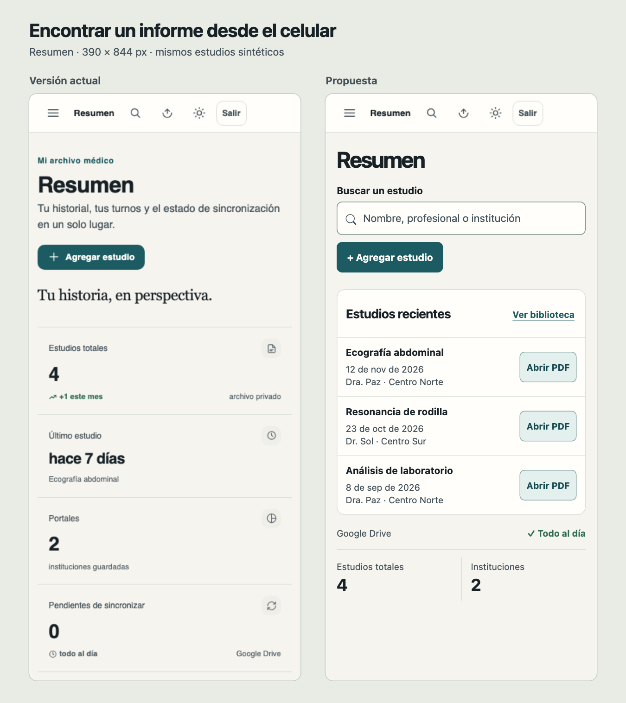

# Auditoría integral de Mis estudios

**19 de noviembre de 2026 · `main` · `9714c7a`**

## Diagnóstico ejecutivo

La prioridad es que **el documento entregado coincida con el que la persona eligió**. Con Drive simulado, un PDF reemplazado después de abrir el diálogo llegó a la API de compartir con los bytes nuevos y el nombre del anterior. Al retirar el adjunto después de la vista previa, el ZIP llegó a contener la ficha JSON bajo una extensión `.pdf`, incluido un enlace al visor que se había excluido. Corresponde comprobar la revisión y el contenido al preparar la descarga o el envío, y pedir una nueva confirmación si la selección cambió. [Descarga de adjuntos](../../src/data/drive-study-repository.ts#L322) · [Exportación](../../src/presentation/components/ExportDialog.tsx#L358) · [Compartir](../../src/presentation/components/ShareDialog.tsx#L150)

La segunda prioridad es la **integridad y recuperabilidad del historial**. Dos ediciones concurrentes se confirmaron y solo quedó la segunda en Drive simulado. Una ficha inválida bloqueó el listado completo. La Bandeja guardó un informe histórico con la fecha del día. Además, un filtro de la Biblioteca se propagó al Resumen y a la búsqueda global, donde ocultó estudios que seguían guardados. [Escritura de estudios](../../src/data/drive-study-repository.ts#L116) · [Carga de estudios](../../src/data/drive-study-repository.ts#L62) · [Bandeja](../../src/presentation/pages/LibraryPage.tsx#L195) · [Estado de la biblioteca](../../src/presentation/state/studiesStore.ts#L62)

La aplicación ya ofrece una base adecuada para un archivo médico personal y familiar con historiales separados por cuenta: Drive como fuente de verdad, procesamiento local de PDF y fotos, búsqueda tolerante a tildes, recuperación desde papelera y cola sin conexión. Recomiendo seguir con Preact, TypeScript, IndexedDB y Drive. La medición apunta a dos optimizaciones concretas dentro del stack actual: limitar cuántas filas se montan y separar los filtros de pantalla del historial visible de la cuenta. [Arquitectura](../architecture.md) · [Decisión sobre Drive y trabajo sin conexión](../adr/0001-offline-drive.md)

### Prioridades

| Prioridad | Implicación |
|---|---|
| **P1** | Puede exponer contenido no elegido, alterar u ocultar datos del historial, impedir un recorrido principal o publicar cambios sin los controles acordados. |
| **P2** | Degrada el uso o la confianza. Existe un camino alternativo o el impacto aparece bajo condiciones acotadas. |
| **P3** | Reduce deuda de mantenimiento o mejora un aspecto específico de la experiencia. |

Las prioridades reflejan el impacto en un archivo personal. Los resultados indican cuándo hubo una reproducción en navegador o con Drive simulado y cuándo la evidencia surge de la inspección.

## 1. Diseño visual y UI

| Elemento | Evaluación y propuesta |
|---|---|
| **Identidad y color** | La base crema, las superficies cálidas y el verde petróleo identifican acciones sin recurrir al azul clínico habitual. El tema oscuro conserva la misma lógica. En la pantalla clara, el texto principal sobre la base dio **14,9:1**, el secundario **7,36:1**, y el texto claro del botón verde **7,65:1**. Mantener la paleta y reservar verde, ámbar y rojo para acciones o estados definidos, acompañados de texto. [Tokens visuales](../../src/presentation/styles/design-tokens.css#L1) |
| **Tipografía y legibilidad** | La tipografía del sistema funciona bien para formularios y registros. La frase editorial en Georgia introduce una jerarquía paralela antes de los estudios. Las notas de indicadores miden 11 px y los ejes de la actividad se reducen junto con el gráfico. Usar la familia del sistema en las superficies operativas y llevar metadatos necesarios a 13–14 px. En móvil, ofrecer los totales por mes también como texto a tamaño de lectura. [Estilo del Resumen](../../src/presentation/styles/library.css#L493) · [Gráfico](../../src/presentation/components/SummaryChart.tsx#L51) |
| **Jerarquía en Resumen · P2** | A **390 × 844 px**, «Estudios recientes» comienza en **y=881**, el primer título en **y=997** y el primer acceso a PDF en **y=1.056**. La primera pantalla entrega cuatro indicadores, mientras buscar un documento requiere identificar la lupa o desplazarse. Poner búsqueda y estudios recientes arriba, conservar el acceso a agregar y mostrar el próximo turno cerca de las tareas cuando exista. Mantener indicadores y actividad más abajo, con conflictos y cambios pendientes visibles desde el inicio cuando requieran acción. [Orden actual del Resumen](../../src/presentation/components/Resumen.tsx#L124) |
| **Consistencia de acciones · P2** | La Biblioteca destina 44 px a los accesos directos que cubren las pruebas móviles, pero PDF, imagen y visor se distinguen por un icono. En Resumen, la apertura del PDF usa otro icono. Usar la misma acción «Abrir PDF», «Abrir imagen» o «Abrir visor» en ambos recorridos y llevar las acciones secundarias a un menú coherente. Mantener una acción principal visible en cada fila. [Acciones de Biblioteca](../../src/presentation/components/StudyList.tsx#L153) · [Acciones de Resumen](../../src/presentation/components/Resumen.tsx#L247) |
| **Captura e importación · P2** | El editor individual ya separa el área desplazable de Guardar y Cancelar. En el lote, la acción para elegir un archivo dice «Elegir PDF», mientras el primer texto indica arrastrar incluso en celular. Mostrar primero la acción de selección en pantallas táctiles y usar el mismo lenguaje para los estados de análisis, revisión, guardado y reintento. Diferenciar en los dos accesos cuándo conviene agregar un informe o importar varios. [Editor](../../src/presentation/components/EditorDialog.tsx#L643) · [Importación](../../src/presentation/components/StudyImportDialog.tsx#L237) |

### Comparativa del Resumen móvil

El boceto conserva la paleta, el ancho y los registros de la captura. El primer botón para abrir un PDF pasa de **y=1.056** en la implementación actual a **y=371** en el boceto. La diferencia es de jerarquía y posición, medida en píxeles CSS. La aceptación requiere una prueba de tareas: abrir un estudio reciente desde la primera pantalla y localizar uno anterior por nombre o profesional en al menos cuatro de cinco ensayos desde un celular, manteniendo el acceso visible a la sincronización cuando haya un problema.

## 2. Experiencia de usuario y accesibilidad

| Hallazgo | Evidencia e impacto | Mejora y aceptación |
|---|---|---|
| **UX-1 · P1 · Un filtro local oculta historial fuera de Biblioteca** | Reproducido en la app con Drive simulado. Con tres fichas, «Ecografía 2» devolvió una porque el conteo agrupa «Ecografía» y «ecografia», mientras el filtro compara el texto literal. Resumen pasó de tres estudios a uno. En otra prueba, la búsqueda global dejó de devolver un estudio existente de un tipo excluido. | Normalizar para contar y filtrar. Construir la vista de la cuenta con servidor y pendientes, y aplicar los tipos solo en Biblioteca. Aceptación: Biblioteca muestra los dos resultados, Resumen conserva los tres y la búsqueda global encuentra el tercero. [Estado de estudios](../../src/presentation/state/studiesStore.ts#L62) · [Conteo de tipos](../../src/domain/library.ts#L177) · [Búsqueda global](../../src/presentation/components/CommandPalette.tsx#L67) |
| **UX-2 · P1 · Un turno oculta documentos asociados** | Un estudio con un PDF válido enlazado mediante `documentIds` mostró «Sin archivo adjunto» en Próximo turno. Se comprobó con la interfaz y Drive simulado. | Resolver fuentes directas y asociadas con la misma lógica que usa la preparación para compartir. Verificar un estudio con PDF propio, otro con PDF asociado y otro con fuente pendiente o ausente. La pantalla debe distinguir los tres estados y abrir solo las fuentes elegidas. [Estudios para llevar](../../src/presentation/components/AppointmentStudies.tsx#L42) |
| **UX-3 · P1 · La Bandeja propone una fecha que parece confirmada** | Un PDF sintético de una página decía 10/11/2020. El flujo guardó 19/11/2026 sin editar la fecha. La Bandeja inicia el borrador con el día de importación y el editor recibe el archivo sin ejecutar la lectura inicial que usa al elegir un adjunto. En la importación por lotes, la prueba de navegador sí comprueba la fecha extraída. | Compartir la lógica de sugerencias y conservar las ediciones manuales. Si falta una fecha fiable, dejar el campo pendiente y exigir revisión. Aceptación: el informe se ubica en 2020 después de confirmar su fecha, y los documentos ambiguos quedan pendientes. [Apertura desde Bandeja](../../src/presentation/pages/LibraryPage.tsx#L195) · [Editor](../../src/presentation/hooks/useEditor.ts#L195) · [Prueba del lote](../../test/e2e/study-import.spec.ts#L3) |
| **UX-4 · P2 · Menú móvil y nombre accesible de marca** | En Chromium, después del último control del menú abierto, Tab llegó a la página cubierta y permitió alcanzar «Salir» y acciones de estudios. En escritorio, axe marcó el nombre accesible de la marca. El enlace se anuncia como inicio y, desde Turnos, conserva Turnos al activarlo. | Al abrir el menú, colocar el foco dentro, volver inerte el contenido cubierto y devolver el foco al disparador al cerrar. Hacer que el enlace de marca vaya a Resumen y que su nombre incluya su texto visible. Probar Tab, Shift+Tab, Escape y control por voz. [Menú y marca](../../src/presentation/components/AppShell.tsx#L52) · [Patrón modal de W3C](https://www.w3.org/WAI/ARIA/apg/patterns/dialog-modal/) · [Etiqueta en el nombre accesible](https://www.w3.org/TR/WCAG22/#label-in-name) |
| **UX-5 · P2 · Compartir puede quedar bloqueado después de cerrar** | Al cerrar con la X durante la preparación y abrir otra ficha, el segundo diálogo quedó en «Preparando…» aun después de completarse la descarga anterior. | Cancelar o invalidar el trabajo al cerrar y reinicializar el estado por ficha. Aceptación: con una descarga demorada, el segundo diálogo permite preparar su propio documento y descarta el resultado anterior. [Preparación y cierre](../../src/presentation/components/ShareDialog.tsx#L113) |
| **UX-6 · P2 · Los dos formularios ofrecen distintos mensajes sobre recordatorios** | Desde Turnos se explican las condiciones del aviso. La entrada desde Resumen ofrece recordatorios sin la misma explicación. El despachador depende de la página abierta, sesión, sincronización, permiso de notificaciones y capacidad del navegador. | Compartir el control y sus mensajes. Indicar las condiciones antes de elegir la antelación y distinguir turno pendiente, permiso rechazado y navegador incompatible. Validar con reloj controlado y luego con iOS y Android físicos. [Turnos](../../src/presentation/components/Appointments.tsx#L266) · [Formulario desde Resumen](../../src/presentation/components/AppointmentDialog.tsx#L218) · [Recordatorios](../../src/presentation/utils/appointmentReminders.ts) |
| **UX-7 · P2 · Dos búsquedas y filtros insuficientemente visibles** | La lupa abre la búsqueda global, mientras Biblioteca filtra estudios. El comportamiento actual de la paleta al seleccionar un estudio abre su editor, aunque la tarea habitual sea consultar el informe. El README describe filtros por fechas y fuentes que la pantalla actual no expone. El recuento de Biblioteca es texto sin anuncio dedicado. | Distinguir búsqueda de estudios y navegación global. Trasladar la consulta desde Resumen a Biblioteca con el término aplicado, anunciar el total con espera breve y ofrecer «Abrir informe» como primera acción donde esté disponible. Validar una búsqueda sin resultados, el retorno desde un estudio y la limpieza de filtros con teclado. [Biblioteca](../../src/presentation/components/StudyListContainer.tsx#L62) · [Paleta](../../src/presentation/components/CommandPalette.tsx#L131) · [README](../../README.md#L31) |

Axe se ejecutó en Chromium en 14 estados de acceso, área autenticada y diálogos. Detectó el problema de la marca en escritorio y dejó 11 elementos de contraste por comprobar visualmente en Resumen. Se calcularon relaciones para el texto principal, secundario, notas y ejes sobre sus fondos sólidos. La Biblioteca clara y oscura y el ancho de 320 px pasaron las reglas ejecutadas y el chequeo de desborde horizontal. Con un área de 640 × 450 px, el editor mantuvo visible Guardar. También se comprobó que el gesto de zoom llega a 2×. Queda pendiente una revisión completa con lector de pantalla, zoom de escritorio y equipo físico. [Pruebas de accesibilidad del repo](../../test/a11y.test.ts) · [WCAG 2.2](https://www.w3.org/TR/WCAG22/)

## 3. Arquitectura técnica, rendimiento y seguridad

### Integridad, privacidad y entrega

| Hallazgo | Evidencia e impacto | Mejora y aceptación |
|---|---|---|
| **T-1 · P1 · Los adjuntos pueden cambiar durante una exportación o un envío** | Drive simulado confirmó ambos escenarios descritos en el diagnóstico. La vista previa valida la firma del estado local, pero `alt=media` descarga la versión que esté vigente en ese momento. La ruta de PDF reetiqueta cualquier respuesta como PDF. | Asociar selección, cuenta y revisión al archivo. Obtener la revisión concreta si Drive lo garantiza o verificar la revisión antes y después de leer. Validar MIME y firma reales. Ante cambio o archivo ilegible, detener la entrega e indicar qué ficha revisar. Probar sustitución por otro PDF válido, retirada, cambio de cuenta y un ZIP con enlaces excluidos. [Vista previa](../../src/presentation/components/ExportDialog.tsx#L119) · [Descarga de estudios](../../src/data/drive-study-repository.ts#L322) · [Preparación para compartir](../../src/presentation/components/ShareDialog.tsx#L138) |
| **T-2 · P1 · La comprobación de versión deja una ventana de escritura concurrente** | En Drive simulado, dos guardados que leyeron la revisión 1 completaron correctamente. Quedó solo la segunda edición, en revisión 3. Web Locks protege la cola entre pestañas del mismo origen y navegador. | Verificar con dos clientes de prueba qué precondición admite Drive para cada endpoint de mutación. Elegir escritura condicional cuando el proveedor la garantice. Si falta esa garantía, preservar revisiones o intenciones por separado y resolver el conflicto explícitamente. Aceptación: una segunda escritura incompatible se conserva como conflicto o variante recuperable. [Guardado](../../src/data/drive-study-repository.ts#L116) · [PATCH](../../src/data/drive-study-repository.ts#L155) · [ADR](../adr/0001-offline-drive.md#límites) |
| **T-3 · P1 · Una ficha inválida bloquea la biblioteca** | Una lectura remota con dos fichas actuales y una histórica con `type` singular cargó las tres. Al sumar una cuarta con tipos vacíos, la lectura falló para toda la colección. Las cuatro seguían en Drive simulado. | Validar por ficha, conservar los originales y mostrar cuántas requieren revisión. Mantener separada la validez de cada ficha del estado completo o parcial del conjunto, incluidos ZIP y validaciones de vínculos. Aceptación: tres registros consultables, un aviso verificable y una exportación completa bloqueada hasta resolver el faltante. [Lectura del listado](../../src/data/drive-study-repository.ts#L62) · [Validación](../../src/data/drive-api.ts#L338) |
| **T-4 · P1 · Pages puede publicar el SHA sin pasar la verificación completa** | CI completo omite los pushes a `main` y la suite de cola. Pages ejecuta Vitest y build. En GitHub, `main` figuraba sin protección y la única ejecución del SHA auditado fue la publicación. | Reusar el trabajo de verificación en PR y publicación, sumar la cola de sincronización y exigir que el artefacto corresponda al mismo SHA verificado, incluso en ejecución manual. Activar controles obligatorios para `main`. Aceptación: cualquier prueba fallida en ese SHA impide publicar. [CI](../../.github/workflows/ci.yml#L3) · [Pages](../../.github/workflows/pages.yml#L17) · [Rama en GitHub](https://api.github.com/repos/carlamadeo/med/branches/main) · [Publicación auditada](https://github.com/carlamadeo/med/actions/runs/44442547577) |
| **T-5 · P2 · Un reintento de Bandeja deja metadatos locales al salir** | Se confirmó que una reserva incierta conserva título, profesional, fecha, institución y URL del visor en `localStorage` tras salir. La prueba comprobó persistencia en el navegador. Las pruebas de cambio de cuenta sí conservaron la cola para su dueño y evitaron mostrarla a la otra cuenta. | Conservar solo el identificador y lo indispensable para reconciliar, o mover la reserva al almacenamiento de pendientes por cuenta. Explicar qué persiste y permitir descarte explícito tras reconciliar el estado remoto. Cambiar «100% privado y en tu nube» por la descripción concreta de Drive y el dispositivo. Revisar si otros sitios comparten el origen de Pages antes de decidir un origen dedicado. [Reserva](../../src/presentation/utils/intakeReservation.ts#L30) · [Cierre de sesión](../../src/data/drive-auth-repository.ts#L29) · [Texto de acceso](../../src/presentation/components/AccessSection.tsx#L56) |
| **T-6 · P2 · Web Share agrega metadatos que la selección no muestra** | En la prueba de «solo enlace», la API nativa recibió también el título y un mensaje con la fecha del estudio. El comportamiento final depende del destino elegido en el sistema. | Construir una carga mínima con lo seleccionado y ofrecer un texto opcional visible antes de abrir el menú nativo. Verificar enlace, archivo y ambos, con y sin texto. [Carga para Web Share](../../src/presentation/components/ShareDialog.tsx#L167) |
| **T-7 · P2 · La Bandeja puede duplicar archivos propios y su alcance real depende del permiso** | En Drive simulado, elegir como origen una carpeta que contenía un PDF ya guardado como estudio permitió crear otra ficha con ese archivo. El selector consulta carpetas visibles por REST con `drive.file`. Ese listado no concede por sí mismo acceso a archivos históricos. | Excluir la carpeta de destino y archivos marcados como propios. Mantener `drive.file` y probar la selección consentida de archivos individuales con Google Picker para los que aún no sean visibles. Validar una carpeta externa y sus hijos con OAuth de prueba antes de ampliar la integración. [Selector](../../src/presentation/components/FolderPickerDialog.tsx#L53) · [Listado](../../src/data/drive-intake-repository.ts#L24) · [Alcances de Drive](https://developers.google.com/workspace/drive/api/guides/api-specific-auth) |
| **T-8 · P2 · Avisos en la cadena de herramientas de desarrollo** | `npm audit` consultó el registro oficial el 19/11. Encontró **26 entradas de paquetes** en el árbol completo: 15 altas, 9 moderadas y 2 bajas. Con `--omit=dev` obtuvo **0**. Parte de las altas está en la cadena de Lighthouse CI. | Revisar primero las actualizaciones del stack de Lighthouse, validar las tres corridas y comprobar el lockfile de nuevo. Incorporar una revisión periódica de dependencias, fijar acciones de publicación a SHAs verificados y separar permisos de compilación y despliegue. [Manifiesto](../../package.json) · [Lockfile](../../package-lock.json) · [Permisos de Pages](../../.github/workflows/pages.yml#L8) |

Dos protecciones actuales merecen mantenerse en las correcciones: el service worker limita su caché a recursos públicos de la aplicación y los flujos de Drive comprueban la cuenta al retomar la sesión. La lectura de adjuntos y los reintentos usan las rutas existentes. Una política de contenido limita scripts y conexiones. Cualquier cambio en descargas o importación debe conservar estas propiedades. [Service worker](../../src/core/service-worker.template) · [Sesión de Drive](../../src/data/drive-api.ts#L117) · [Política de contenido](../../index.html#L9)

### Rendimiento y capacidad

Medianas de tres corridas en un Mac Apple M1 con 16 GB, Chromium y perfil móvil Pixel 5 a 390 × 844 px. La compilación de producción se sirvió por localhost con Drive paginado simulado, contexto nuevo por corrida y sin latencia artificial. «Abrir Biblioteca» y los cambios de búsqueda miden desde la interacción hasta dos cuadros de renderizado. Conservar condiciones y fixture al repetir.

| Medición | Sin sesión | 200 estudios | 1.000 estudios |
|---|---:|---:|---:|
| Acceso disponible | 91 ms | — | — |
| Resumen con datos | — | 124 ms | 150 ms |
| Abrir Biblioteca | — | 74 ms | 266 ms |
| Buscar un único resultado | — | 29 ms | 22 ms |
| Limpiar la búsqueda y volver a la lista completa | — | 50 ms | 210 ms |
| Filas de estudios / elementos de la tabla montados | — | 200 / 7.430 | 1.000 / 37.030 |

El costo medido se concentra en **montar la lista y restaurarla**. La búsqueda selectiva ya responde en decenas de milisegundos en este equipo. La implementación actual crea una fila por estudio. El selector de turnos también montó 200 y 1.000 casillas, respectivamente. Priorizar paginación accesible o virtualización con foco estable, preservando el mismo conjunto lógico para búsquedas, impresión y ZIP. En el selector de turnos, incorporar una búsqueda que conserve elecciones fuera del resultado actual. Meta propuesta para repetir el ensayo: abrir y restaurar 1.000 resultados en menos de 150 ms de mediana y mantener selección, foco y recuentos exactos. [Lista actual](../../src/presentation/components/StudyList.tsx#L67) · [Selector de turnos](../../src/presentation/components/AppointmentStudies.tsx#L9)

En Chromium de escritorio contra Vite, un PDF sintético de una página con texto tardó **94 ms** y el mismo contenido escaneado **391 ms**, mediana de tres lecturas por formato. Ambos devolvieron fecha, tipo y profesional. Son muestras pequeñas en localhost. Antes de optimizar OCR, medir en teléfono un lote mixto y un PDF largo: tiempo hasta la primera sugerencia, tiempo total y cancelación. La compilación produjo aproximadamente **103 kB comprimidos** para JavaScript y CSS de entrada y **31 MB** de recursos PDF/OCR en el artefacto local. Los recursos de lectura se sirven bajo demanda. [Configuración de compilación](../../vite.config.ts) · [Workers](../../src/data/pdf-analysis.ts) · [Fixtures de PDF y OCR](../../test/e2e/pdf-worker.spec.ts)

Para archivos grandes, el ZIP carga los adjuntos en memoria y genera un único Blob al final. Es un riesgo de escala derivado del código, con umbral real pendiente de medir. Instrumentar progreso, tiempo, cancelación y pico de memoria con paquetes sintéticos representativos. Si el límite en móvil lo requiere, ofrecer exportación por partes o generación incremental conservando un manifiesto de alcance y revisiones consistentes. Medir también solicitudes de Drive antes de introducir sincronización incremental. La API se consume por páginas de 100 y la caché evita parte de esas lecturas. [Generación ZIP](../../src/presentation/components/ExportDialog.tsx#L358) · [Paginación Drive](../../src/data/drive-api.ts#L320)

### Mantenimiento

La aplicación ya separa dominio, repositorios, infraestructura y UI. El mayor valor de refactorización está en las reglas compartidas que hoy divergen entre recorridos: resolución de adjuntos, condiciones de recordatorios, separación de colección y filtro y verificación de revisiones. Pasar esas reglas a una única ruta después de fijar pruebas desde los puntos de entrada. Actualizar README y la guía técnica sobre fotos, filtros, búsquedas, lista actual y estado de las exportaciones. Una ejecución simultánea de `predev` y `prebuild` falló en `public/vendor`; la ejecución secuencial completó. Ambos regeneran el mismo directorio. Conviene usar preparación reutilizable o generación atómica antes de paralelizar esos trabajos. [Arquitectura](../architecture.md) · [Preparación de recursos](../../scripts/vendor.mjs#L15) · [Guía de verificación](../verificacion.md#exportación-y-envío)

## 4. Expansión de producto

| Orden | Capacidad | Primera versión y costo | Señal para avanzar |
|---|---|---|---|
| **1** | **Preparar una consulta** | Extender «Estudios para llevar». Añadir búsqueda y selección persistente en la lista, resolver adjuntos asociados y mostrar una vista previa de los archivos elegidos para abrir o preparar juntos. Esfuerzo medio y permisos actuales. | Encontrar tres informes entre 200 en menos de 60 s en cuatro de cinco ensayos, abrirlos desde el turno y obtener cero fuentes ajenas. Depende de UX-2 y T-1. [Selector actual](../../src/presentation/components/AppointmentStudies.tsx#L9) |
| **2** | **Llevar un turno al calendario** | Botón de descarga `.ics` a demanda con fecha, hora, zona y título neutro. La persona elige si agrega una alarma. Esfuerzo bajo a medio y sin acceso de lectura al calendario. Explicar cómo actualizar la copia al reprogramar. | Validar hora local y recepción del aviso con la app cerrada en calendarios de iOS y Android. Probar una reprogramación y los casos sin permiso de notificaciones del navegador. [iCalendar](https://www.rfc-editor.org/rfc/rfc5545) |
| **3** | **Retomar una importación histórica** | Ofrecer conservación local opcional de los borradores por cuenta y detección de PDFs renombrados entre tandas con huellas de contenido. Permitir revisar coincidencias y vaciar pendientes. Esfuerzo medio a alto y permisos actuales. La huella ya se usa para comparar dentro de una tanda. | Cargar 20 PDFs sintéticos con renombrados y repetidos, interrumpir y retomar. Cero duplicados confirmados sin aviso y cero borradores visibles desde la otra cuenta. Depende de corregir la fecha y el origen de Bandeja. [Detección actual](../../src/presentation/components/StudyImportDialog.tsx#L124) |
| **4** | **Incorporar archivos históricos desde Drive** | Piloto con selección explícita de archivos, contexto visible de cuenta y previsualización del contenido antes del guardado. Esfuerzo medio. Validar la configuración de Picker con el permiso existente. | Seleccionar y guardar un documento previamente ajeno a la app con OAuth de prueba, y conservar la separación de cuentas al revocar y volver a conectar. [Alcances de Drive](https://developers.google.com/workspace/drive/api/guides/api-specific-auth) |

Las cuatro propuestas se ajustan al uso personal y familiar con un historial por cuenta. Sus metas son criterios de producto para validar con personas. La cantidad de documentos encontrados y el tiempo de tarea se pueden registrar sin conservar consultas, títulos, notas ni enlaces.

## Auditoría del 14 de noviembre revalidada

| Hallazgo anterior | Estado al 19 de noviembre |
|---|---|
| **01 · Alcance del ZIP filtrado** | **Resuelto en la matriz probada.** Descomprimí un ZIP con un estudio y su PDF, una operación, un portal, una consulta, un turno y cero episodios. Contenido y recuentos coincidieron con la selección. [Proyección del alcance](../../src/domain/export-scope.ts#L28) |
| **02 · Completitud del ZIP** | **Parcial.** La carga incompleta y los pendientes bloquean la entrega. Pasaron las comprobaciones de cuenta y adjuntos faltantes. T-1 documenta un problema distinto cuando el adjunto cambia después de la vista previa. [Precondiciones](../../src/presentation/components/ExportDialog.tsx#L29) |
| **03 · Concurrencia entre dispositivos** | **Vigente y reproducido con Drive simulado.** Ambas escrituras fueron aceptadas. Falta confirmar la semántica del proveedor con dos clientes de prueba. |
| **04 · Una ficha ilegible bloquea la biblioteca** | **Vigente y reproducido con registros actuales e históricos.** La transformación del listado falla al llegar a la ficha inválida. |
| **05 · Señal de CI y publicación** | **Vigente en GitHub.** El SHA de `main` se publicó sin la ejecución del workflow amplio. La suite local de hoy pasó. |
| **06 · Privacidad y recuperación** | **Parcial.** Pasaron los escenarios simulados de aislamiento, cola y recuperación. Se confirmó persistencia local de una reserva incierta. Quedan pendientes Drive real, dispositivo compartido y cuota de almacenamiento. |
| **07 · Alcance de los recordatorios** | **Parcial.** La explicación existe en Turnos y falta en el formulario desde Resumen. |
| **08 · PDF e imágenes en el ciclo documental** | **Resuelto para los casos centrales verificados.** Alta individual, OCR, compartición y ZIP cubren PDF y fotos JPEG/PNG. UX-2 identifica una brecha al recuperar documentos relacionados desde un turno. |
| **09 · Importación asistida** | **Parcial.** Hay selección por cuenta, recarga, tamaño y reserva de altas. Persisten la fecha de la Bandeja, la autoduplicación y el alcance de archivos externos en Drive real. |
| **10 · Documentación y mantenimiento** | **Parcial.** El ADR está versionado y se realizó la revisión de dependencias. La guía todavía presenta como abiertos problemas históricos del ZIP y el README conserva descripciones de filtros y búsquedas que quedaron desfasadas. [Auditoría anterior](2026-11-14-auditoria-y-hoja-de-ruta.md) |

## Verificación y límites

| Control | Resultado |
|---|---|
| Entorno | Node.js **24.14.0**, dependencias instaladas del proyecto y OAuth simulado para flujos autenticados. |
| TypeScript, lint y build | Los tres completaron. La compilación usó un identificador OAuth sintético. |
| Vitest con cobertura | **313/313** en 57 archivos en cada una de tres corridas con dos procesos de Vitest. Dominio, datos y núcleo alcanzaron **88,31 %** en líneas, **75,72 %** en ramas, **85,81 %** en funciones y **82,27 %** en sentencias. Los umbrales del repo se cumplieron. |
| Playwright general | **53 aprobadas, 1 omitida**. Chromium de escritorio, Chrome móvil emulado y WebKit con perfil de iPhone. WebKit omite la validación de bytes multipart de un guardado. Sí se recorrió la importación mixta válida e inválida en los tres perfiles. |
| Producción sin conexión | **1/1** bajo `/med/`. Recargó la interfaz y el recurso PDF previamente consultado con el service worker activo. |
| Cola sin conexión | **3/3**. Sincronización única al reconectar, cambio entre dos cuentas simuladas y conservación de un cambio con revisión obsoleta. |
| Lighthouse | Tres corridas del acceso. Rendimiento **97–98**, accesibilidad **100**. El rendimiento de la Biblioteca se midió aparte mediante las interacciones de navegador descritas arriba. |
| Comprobaciones dirigidas | Se inspeccionaron bytes de ZIP y de Web Share, cambios de revisión, ficha histórica e inválida, reservas locales, filtro de tipos, documentos asociados, duplicación de Bandeja, fecha y foco móvil. Se usaron datos sintéticos. |

La auditoría local y la consulta de estado de GitHub cubren la revisión indicada. La edición concurrente y la carga de adjuntos se comprobaron con Drive simulado. La aceptación en teléfono físico, lector de pantalla, destino real de compartir, OAuth con dos cuentas de prueba, almacenamiento lleno y cambios de red durante una subida requieren una sesión de validación dedicada. Las capturas y el boceto usan cuatro estudios ficticios. [Guía de pruebas](../verificacion.md) · [Perfiles de navegador](../../playwright.config.ts)

## Hoja de ruta

| Fase propuesta | Entrega para una persona desarrolladora | Criterio de avance |
|---|---|---|
| **1 · Integridad y publicación · 1–2 semanas** | Resolver entrega de adjuntos por revisión, fecha de Bandeja y lectura parcial. Hacer obligatorios los controles sobre el SHA publicado. En paralelo, verificar escrituras concurrentes con Drive de prueba. | Cero archivos o enlaces fuera de selección. Una ficha defectuosa deja consultables las demás. Ningún cambio de fecha implícito. Un fallo en CI bloquea Pages. |
| **2 · Encontrar y recuperar · 1–2 semanas** | Aislar filtros, resolver documentos de turnos, arreglar foco móvil y flujo de compartir. Probar el nuevo orden del Resumen y reducir el costo de montar listas extensas. Alinear copia y documentación con cada flujo. | Búsqueda global completa. Primer PDF accesible en la primera pantalla. Cuatro de cinco tareas móviles completadas. Cumplimiento de la meta de lista con 1.000 registros y foco comprobado. |
| **3 · Confianza y expansión · después de la aceptación** | Cerrar el mecanismo de conflictos de acuerdo con la prueba de Drive. Validar recuperación y privacidad con dos cuentas y dispositivos reales. Pilotear la preparación de consultas y la exportación de turnos. | Toda edición simultánea se conserva o se señala como conflicto recuperable. Se abren solo los documentos elegidos. El evento importado conserva hora y zona en ambos calendarios. |

Los plazos son orientativos y dependen de la validación en Drive real. La aceptación visual debe comparar las mismas tareas y datos antes y después, además de revisar textos largos, temas claro y oscuro, y estados sin conexión, pendientes o con conflicto.

